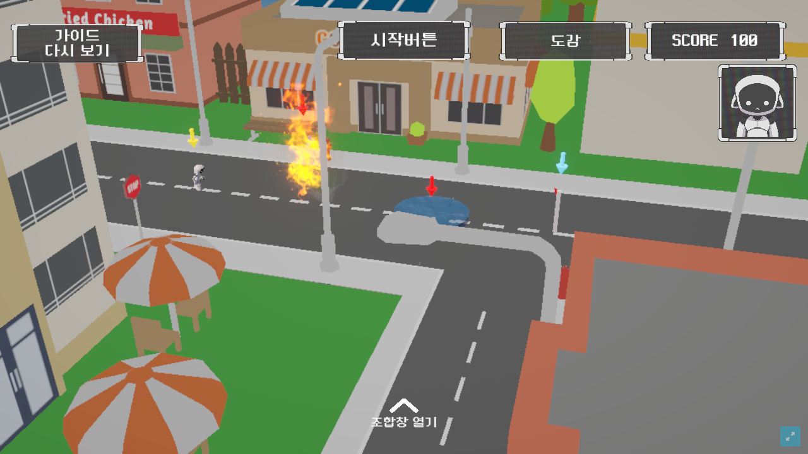
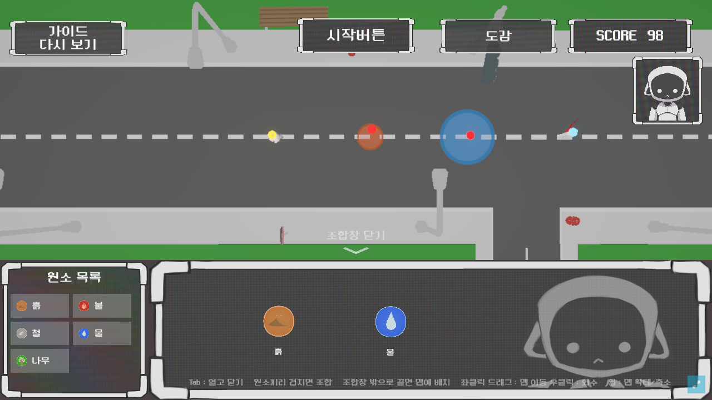
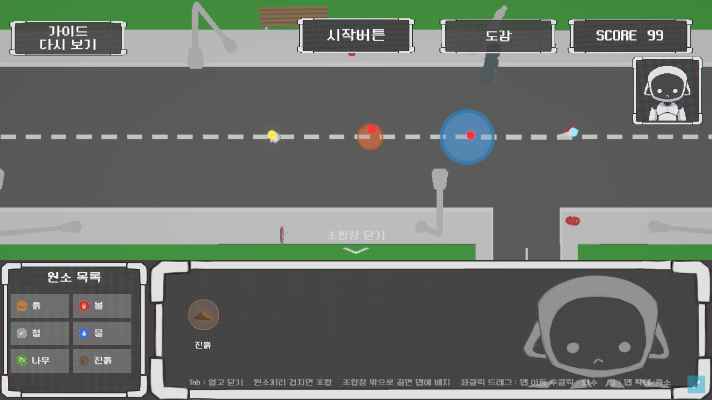

# PRJMix

> 두 원소를 조합해 새로운 원소를 발견하고, 스테이지에 배치해 함정을 풀어 나가는 Unity 퍼즐 게임

[](https://prjmix-webgl.vercel.app/)


🏆 **대전게임콘텐츠협회장상** 수상 (대전 인디 게임잼, 2026)
▶ **[웹에서 바로 플레이하기](https://prjmix-webgl.vercel.app/)**



| 조합 전: 흙과 물을 조합창에 꺼냄 (SCORE 98) | 조합 후: 진흙 발견, 원소 목록에 등록 (SCORE 99) |
|---|---|
|  |  |

---

## 게임 소개

여러 행성을 탐험하던 외계 로봇 믹소봇이 지구에 불시착합니다. 플레이어는 불, 물, 나무, 흙, 철 같은 기본 원소를 조합해 새로운 원소를 발견하고, 그 원소를 스테이지에 배치해 함정과 장애물을 무력화합니다.

**핵심 플레이 흐름**

1. 조합창(Tab 또는 마우스 휠)에서 두 원소를 겹쳐 새 원소를 만든다
2. 새로 발견한 원소는 원소 목록과 도감에 등록된다
3. 시작 전 준비 단계에서 원소를 격자 칸에 배치한다
4. 시작 버튼을 누르면 캐릭터가 이동하고, 배치한 원소가 함정을 상쇄한다
5. 실패하면 스테이지가 초기화되고 다시 시도한다

## 개발 정보

| 항목 | 내용 |
|---|---|
| 기간 | 2026.08 게임잼 3일 프로토타입 → 정식 프로젝트로 확장, 현재 고도화 중 |
| 팀 | 6인 (프로그래밍·기획·아트) |
| 엔진 | Unity 6 (6000.0.81f1), URP |
| 언어 | C# |
| 배포 | WebGL (Vercel) |

## 담당 파트 — 이건호 (프로그래밍 팀장)

원소 생성·조합 시스템, 조합 UI, 도감, 게임 진행 흐름, 점수 시스템을 담당했습니다.

### 1. ScriptableObject 기반 원소·조합 데이터

원소와 조합식이 계속 늘어날 예정이라, 조건문을 고치지 않고 **데이터만 추가해 확장**할 수 있게 설계했습니다.

- `ElementData` — 원소 이름, 종류, 기본 원소 여부, 점수, 아이콘, 설명, 맵에 놓을 3D 모델
- `ElementCombinationData` — 재료 원소 두 개와 결과 원소

```csharp
// Assets/script/Element/ElementCombinationData.cs
public bool IsMatch(ElementData elementA, ElementData elementB)
{
    return
        (firstElement == elementA && secondElement == elementB) ||
        (firstElement == elementB && secondElement == elementA);
}
```

`물 + 불`과 `불 + 물`이 같은 조합식 하나로 처리되도록 양방향으로 비교합니다. 순서만 다른 조합식을 중복 등록할 필요가 없습니다.

### 2. 조합 UI와 이벤트로 분리한 성공·실패 처리

`CraftingPanelUI`는 원소를 드래그해 겹치면 등록된 조합식을 찾아 결과를 만듭니다. 새로 발견한 원소는 목록에 추가하고, 결과는 정적 이벤트로 알립니다.

```csharp
// Assets/script/Element/CraftingPanelUI.cs
public static event System.Action CombineSucceeded;
public static event System.Action CombineFailed;
```

로봇 표정 UI처럼 조합 결과에 반응해야 하는 쪽은 이 이벤트만 구독합니다. 조합 로직이 UI 반응을 직접 알지 않아도 됩니다.

### 3. 도감

`EncyclopediaPanel`은 원소와 장애물 두 카테고리로 나뉘고, 페이지를 넘기며 확인합니다. 도감이 열린 동안에는 다른 UI와 게임 진행을 막아 화면이 겹치거나 캐릭터가 의도치 않게 움직이지 않게 했습니다.

### 4. 점수 시스템 — 데이터와 표시 분리

| 행동 | 점수 |
|---|---|
| 시작 | 100점 |
| 조합창에서 재료를 꺼냄 | −1 |
| 꺼낸 재료를 그대로 되돌림 | +1 |
| 조합 성공 | 결과 원소의 `Score` (대부분 +1, 늪처럼 일부 +2) |

`ScoreSystem`은 점수 규칙만, `ScoreUI`는 표시만 담당하고 `ScoreChanged` 이벤트로 연결됩니다.

### 5. 게임 진행 흐름

- `StageStartButton` — 시작 전에는 캐릭터 이동을 막아 원소를 조합·배치할 시간을 주고, 시작 시 `StageStarted`를 알립니다
- `StageReset` — 시작 버튼과 사망 후 리스폰, 두 가지 이유(`Reason`)로 스테이지를 초기 상태로 되돌리는 신호를 한곳에서 보냅니다

### 6. WebGL 배포 중 해결한 문제

에디터에서는 보이던 이펙트가 WebGL 빌드에서만 출력되지 않았습니다. 렌더링 설정과 셰이더를 하나씩 바꿔 다시 빌드하며 원인을 좁힌 결과, 셰이더가 WebGL에서 지원하지 않는 높은 셰이더 모델을 요구하고 있었습니다. 에디터는 DirectX 환경이라 문제없이 보였지만, 웹 빌드는 쓸 수 있는 그래픽 기능이 제한되어 있었습니다. 웹 호환 셰이더와 머티리얼로 교체해 해결하고, 같은 셰이더를 쓰는 다른 스테이지까지 다시 확인한 뒤 배포했습니다. 위 스테이지 화면의 불 함정 이펙트가 WebGL 빌드에서 출력되는 모습입니다.

### 협업

- 5단계 원소 티어 전체를 기간 안에 만들기 어렵다고 판단해, 하위 티어는 조합 다양성을 확보하고 상위 티어는 대표 원소에 집중하는 범위 조정을 제안했습니다
- 업무를 기능 단위로 나눠 기획·아트 팀원과 범위와 일정을 조율했습니다

## 팀원 담당 파트

6인 팀입니다.

| 이름 | 담당 |
|---|---|
| 이건호 ([@Lee-GunHo](https://github.com/Lee-GunHo)) | 개발 팀장 · 원소 조합 · 조합 UI · 도감 · 게임 진행 · 점수 · WebGL 배포 |
| 조문성 | 원소 3D 모델·머티리얼 · 배치 격자 · 함정 판정과 함정 UI · 에디터 도구 |
| 이풍은 | 스테이지 레벨 디자인 · 맵 · 카메라 · 함정 연출 |
| 권정오 | 게임 기획 |
| 김민형 | 아트 |
| 김용현 | 아트 |

## 폴더 구조

```
Assets/script/
├── Element/   원소·조합 데이터, 조합 UI, 배치 시스템
├── Scene/     도감, 시작 버튼, 실패 패널 등 스테이지 UI
├── System/    점수, 스테이지 리셋, 사운드, 메뉴 매니저
├── Trap/      함정과 원소 상쇄 효과
├── Player/    플레이어 이동·사운드
└── Editor/    함정 배치·데이터 빌드 보조 에디터 도구
```

## 실행 방법

1. Unity Hub에서 **Unity 6000.0.81f1**로 프로젝트를 엽니다
2. `Assets/Scenes/MainScene.unity`를 열고 Play 합니다 (메인 → `StageSelectScene` → `Stage_01`~`Stage_03`)

또는 **[웹에서 바로 플레이](https://prjmix-webgl.vercel.app/)** 할 수 있습니다.
